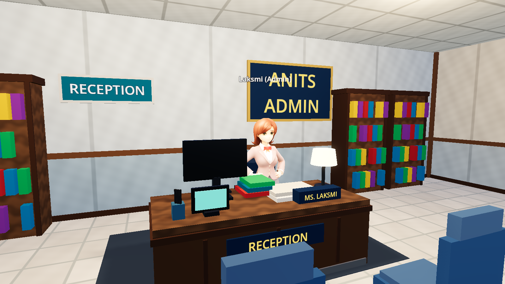

# ANITS College Simulation — Godot 4 port

A third-person campus game rebuilt from the original **ANITS – First Day** web game
in **Godot 4.7.2**. Same campus, same models, same voices, same Day 1 story — now
with roads around the whole college, a photo main menu, a 5 × 2 level-select grid,
a stride-matched walk cycle and an adaptive 60 fps quality ladder.

**Play in the browser:** <https://akhilboss118-an.github.io/anits-college/>

**Android APK (v1.0):** [download the signed arm64 APK](https://github.com/akhilboss118-an/anits-college/releases/download/v1.0/ANITS-College-Simulation-v1.0.apk)
(111.5 MB) — or build it locally with the command in [Build](#build).

---

## What is in the build

| Area | Content |
| --- | --- |
| Campus | 17 buildings, 12 streets, 6 wall runs, main gate + Back Gate, Admin Office interior, 150 trees, 130 bushes, 4,200 grass tufts, 91 parked cars, benches, lamps, vending machines |
| People | 64 animated NPCs with name labels, routes and the original dialogue, plus the player (Mike / Amy) |
| Story | Day 1 plays start to finish: guard → gate → Laksmi → Prof. Rao → Suresh → Arjun → salute → Colonel → *Day 1 Complete!* |
| Front end | Year select (2023–2025 uniforms), character select with live 3D previews, name entry, photo main menu, 10-card level grid, loading screen |
| UI | Anchored HUD (mission, wallet, energy, minimap, prompts, subtitles, toasts), pause menu, touch layout with a virtual stick |
| Audio | The web build's original voice clips; **no music** |
| Modes | `--check` scripted tour, `--beauty` screenshot pass, `--touch-preview` phone layout, `--menu-shot` menu captures |

## Controls

### Keyboard and mouse

| Input | Action |
| --- | --- |
| `W` `A` `S` `D` / arrow keys | Move |
| `Shift` | Run |
| Mouse drag | Orbit the camera |
| `Q` / `Z` | Turn the camera left / right |
| `E` | Talk / use / advance dialogue |
| `G` | Salute |
| `Esc` | Pause |

### Touch

Left thumb stick to move, drag anywhere on the right to look, and the on-screen
`E`, `G` and `RUN` buttons. The touch layer only appears on touch devices (or with
`-- --touch-preview`).

## Performance

The frame rate is protected on every platform. MSAA is off, the 3D buffer starts
at **0.88** on desktop and **0.78** on mobile, and if the game stays below
**58 fps** for three seconds it steps the render scale down (desktop
`0.88 → 0.78 → 0.68 → 0.60`, mobile `0.78 → 0.68 → 0.58 → 0.50`) and finally
turns the sun shadow off.

Measured on a Windows 11 laptop with an AMD Radeon integrated GPU (1080p,
Forward+, D3D12):

| Run | Settled scale | fps avg | Draw calls | Primitives | Verdict |
| --- | --- | --- | --- | --- | --- |
| Spawn view, desktop start | 0.88 | 43.5 | 132 | 2.10 M | below target |
| Spawn view, adaptive ladder | **0.60** | **59.4** | 132 | 1.43 M | **PASS** |
| Phone profile | 0.78 | 52.6 | 132 | 2.16 M | below target |

The full plan, budgets and knob list are in
[`tests/PERFORMANCE.md`](tests/PERFORMANCE.md).

## Build

Godot **4.7.2** and the matching export templates are required. The presets are
already in `export_presets.cfg`.

```powershell
$GODOT = "C:\Users\AKHILBOSS\Desktop\Godot_v4.7.2-stable_win64.exe"
$PROJ  = "C:\Users\AKHILBOSS\Desktop\ANITS-GODOT\new-game-project"

# Web (GitHub Pages) — writes build/web/
& $GODOT --headless --path $PROJ --export-release "Web" "$PROJ\build\web\index.html"
New-Item -ItemType File -Path "$PROJ\build\web\.nojekyll" -Force

# Android — writes a signed arm64 release APK
& $GODOT --headless --path $PROJ --export-release "Android" "$PROJ\build\anits.apk"
```

The shipped APK is `build/ANITS-College-Simulation-v1.0.apk`
(111.5 MB, `com.akhilboss.anits`, version 1.0, minSdk 24, targetSdk 36,
arm64-v8a, signed with the debug keystore). Its SHA-256 is
`1bb242680b2de161bebf98c2a6c226eb30adce43ac653fa457a3cadca527544d`.

## Run and verify

```powershell
# play from source
& $GODOT --path $PROJ

# headless gate: import, 61 unit checks, smoke run, scripted tour
powershell -ExecutionPolicy Bypass -File "$PROJ\verify.ps1"

# benchmark
& $GODOT --path $PROJ --script res://tests/bench.gd -- `
    --bench-profile=desktop --bench-spot=spawn --bench-warmup=14 --bench-seconds=5
```

`verify.ps1` currently reports **61 checks, 0 failures**, and the tour walks the
whole Day 1 route while writing the screenshots in `docs/screenshots/godot/`.

## Screenshots

| | |
| --- | --- |
|  |  |
| Main gate and entrance boulevard | Campus aerial with the perimeter road |
|  |  |
| Admin Office interior | Level select — 5 × 2 Day cards |

More in [`docs/screenshots/godot/`](docs/screenshots/godot/).

## Project layout

| Path | What it is |
| --- | --- |
| `src/main.gd` | root scene: environment, campus, player, NPCs, HUD, mission, adaptive quality, capture modes |
| `src/autoload/` | `game_state`, `mission_runner`, `dialogue_service`, `voice_bank`, `settings`, `campus_db`, `event_bus`, `save_system` |
| `src/world/` | campus geometry, props and materials, character rigs, original model loader, Admin Office interior |
| `src/actors/` | player controller + camera boom, NPC rigs and routes |
| `src/ui/` | HUD, touch controls, main menu and level grid |
| `src/data/` | campus layout, NPC tables, economy (ported from the web build) |
| `third_party/anits_original/` | the original models, textures and 632 voice clips |
| `tests/` | `run_tests.gd`, `bench.gd`, `PERFORMANCE.md` |
| `docs/` | screenshots, report source and PDF, deployment and design notes |

## Deployment

- **Source** lives on `main`.
- **Playable web build** lives on the `gh-pages` branch and is served by GitHub
  Pages from the branch root. `build/web/` is intentionally not tracked on
  `main`.
- Redeploy = rebuild `build/web`, copy it to a temporary repo, add `.nojekyll`,
  and push `HEAD:gh-pages`. The full recipe, including the SSH deploy-key
  workaround for GitHub's 100 MB / timeout limits, is in
  [`docs/DEPLOYMENT.md`](docs/DEPLOYMENT.md).

## Report

A 32-page technical report covering the port — architecture, campus and roads,
character pipeline, walk cycle, UI, touch controls, rendering, performance,
testing and deployment — is at
[`docs/ANITS_Godot_Report.pdf`](docs/ANITS_Godot_Report.pdf) (25.9 MB). The
source is [`docs/report/report.html`](docs/report/report.html); rebuild it with
`docs/report/build_report.ps1`.

## Credits and licensing

The 3D models, textures and voice clips are the original ANITS web game's assets
and remain the property of their authors; they are included here for this port
only. Engine, sky and third-party asset licences are catalogued in
[`docs/EXTERNAL_ASSET_LIBRARY.md`](docs/EXTERNAL_ASSET_LIBRARY.md) and
[`docs/ASSET_MAPPING.md`](docs/ASSET_MAPPING.md).
