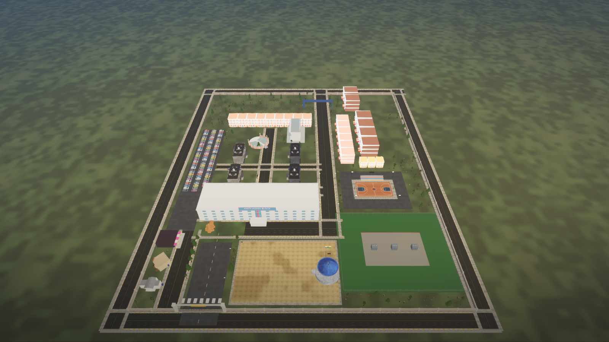
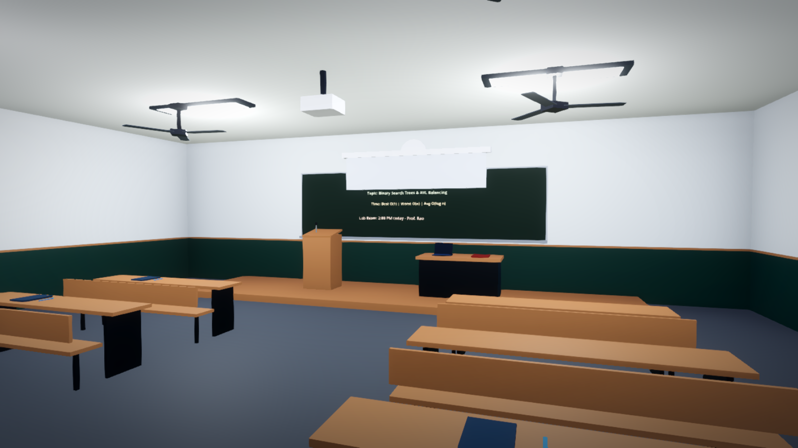
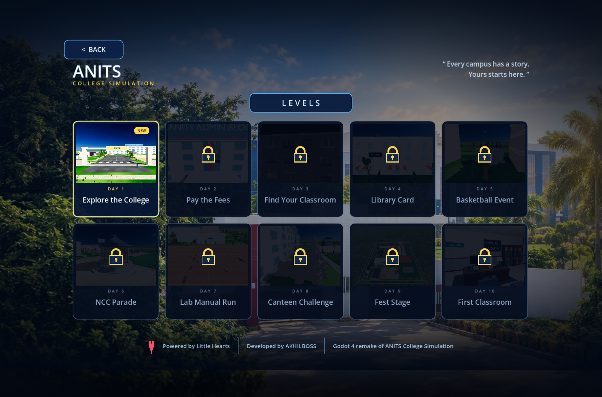

# ANITS College Simulation — Godot 4 port

A third-person campus game rebuilt from the original **ANITS – First Day** web game
in **Godot 4.7.2**. Same campus, same models, same voices — now with the complete
**10-day campaign**, four walk-in interiors, five minigames, a student bag, roads
around the whole college, a photo main menu, a 5 × 2 level-select grid, a
stride-matched walk cycle and two adaptive quality profiles tuned for desktop and
low-end mobile.

**Play in the browser:** <https://akhilboss118-an.github.io/anits-college/>

**Android APK (v1.0):** [download the signed arm64 APK](https://github.com/akhilboss118-an/anits-college/releases/download/v1.0/ANITS-College-Simulation-v1.0.apk)
(115.6 MB) — or build it locally with the command in [Build](#build).

---

## What is in the build

| Area | Content |
| --- | --- |
| Campus | 17 buildings, 12 streets, 6 wall runs, main gate + Back Gate, four walk-in interiors (Admin Office, Central Library, Room 204, Canteen), 150 trees, 130 bushes, 4,200 grass cards, 91 parked cars, benches, lamps, vending machines. Flat-colour imported buildings are merged into single meshes and the row blocks are MultiMesh batches; phones drop to 83 trees / 72 bushes / 1,680 grass cards / 50 cars |
| People | 64 NPCs with name labels, routes and the original dialogue (62 animated rigs), plus the player (Mike / Amy) |
| Story | All 10 days play from start to finish. Day 1 tutorial; fees, bank ATM and Room 204 on Day 3; library quiz, basketball, NCC drill and fest; lab-manual run; canteen challenge; final first-class quiz. Each day unlocks the next. |
| Minigames | Basketball shootout with mouse/touch aim and a THROW button (gravity arc, rim and backboard collisions, 7 s shot clock, 5 shots / 3 hits), NCC cadence drill, samosa typing, fest dance battle, quiz engine, plus mash and command QTE variants — all with keyboard and touch input |
| Inventory | Student bag on `B` / touch **Bag**: ID card, stamped fee receipt, library card and signed lab manual; **SHOW ID** clears the gate check on every day. Canteen Collection tracks all 10 drinks and awards the Campus Foodie badge. |
| Front end | Year select (2023–2025 uniforms), character select with live 3D previews, name entry, photo main menu, 10-card level grid, loading screen |
| UI | Anchored HUD (flag mission card, top-centre energy pill, gold-framed minimap, circular pause, keycap action prompts, subtitles, toasts), pause menu, settings, touch layout with a virtual stick. All icons are procedural white glyphs on dark circular badges with gold arcs (`src/ui/ui_icons.gd`), so the UI stays crisp at any resolution with no image assets. |
| Audio | The web build's original 632 voice clips, procedural SFX and looping campus/interior ambience; **no music bed** (see [`src/autoload/AUDIO_NOTES.md`](src/autoload/AUDIO_NOTES.md)) |
| Modes | `--check` scripted tour, `--beauty` / `--beauty-low` screenshot passes, `--touch-preview` phone layout, `--menu-shot` menu captures, `--low-poly` / `--quality-fast` fast profile, `--quality-high` high profile, `--dev` / `--unlock-all` developer mode |

## Controls

### Keyboard and mouse

| Input | Action |
| --- | --- |
| `W` `A` `S` `D` / arrow keys | Move |
| `Shift` | Run |
| Mouse drag | Orbit the camera |
| `Q` / `Z` | Turn the camera left / right |
| `E` | Talk / use / advance dialogue |
| `G` | Salute |
| `B` | Open the student bag (show ID during gate checks) |
| Mouse move / drag | Aim the basketball shot |
| Click / `Space` | Throw the basketball (or use the on-screen THROW button) |
| `Esc` | Pause |

### Touch

Left thumb stick to move, drag anywhere on the right to look, and the on-screen
action buttons: a contextual glyph (door, talk, cart, book, water …) that mirrors
the desktop prompt, `G` salute, `RUN` and `BAG`. Each is a white glyph on a dark
circular badge with a gold arc; the RUN badge uses a right-hand arc. The touch
layer only appears on touch devices
(or with `-- --touch-preview`), and only once a level has started — the menus and
level grid stay clean. In the basketball shootout, drag to aim and tap the
**THROW** button.

## Developer mode

A persistent local switch for testing the campaign. Turn it on from
**Settings → DEVELOPER MODE**, or press `F9` / `Ctrl+Shift+D` on any menu
screen. A gold **DEVELOPER MODE ON** badge appears on the main menu while it is
active, and the level-select screen gains a **★ UNLOCK ALL LEVELS** button.
The setting is saved in `user://settings.cfg` (`[dev] enabled`) and stays on
across launches until you press **TURN OFF DEV MODE**.

| Tool | What it does |
| --- | --- |
| **★ UNLOCK ALL 10 LEVELS** | Opens every day on the level grid and writes `unlocked_day = 10` to `profile.json` |
| **START AT ANY DAY** | Slider from Day 1 to Day 10, then **START DAY N** jumps straight into that level |
| **RESET ALL PROGRESS** | Two-step confirm; clears the save so only Day 1 is open and Day 1 is the start point |
| `F9` / `Ctrl+Shift+D` | Open the developer panel from any menu screen |
| `-- --dev` | Launch with developer mode already enabled |
| `-- --unlock-all` | Launch with developer mode enabled **and** every day unlocked |

Developer mode only changes menu access and the save file — the campaign,
missions, minigames and 60 fps target are untouched, so a dev-unlocked day plays
exactly like one reached normally.

## Performance

The frame rate is protected on every platform. MSAA is off, and the game ships
two render profiles:

- **HIGH (desktop Forward+)** starts at **0.88**. If the game stays below **58 fps**
  for three seconds the ladder steps the 3D scale to **0.78 → 0.68 → 0.60**,
  turns SSAO and volumetric fog off, switches to one shadow split and finally
  turns the sun shadow off.
- **FAST (phone / web-touch / integrated laptop GPU)** starts at **0.60**,
  replaces the Sky3D atmosphere with a cheap procedural sky and depth fog, uses
  one 64 m shadow split with no tree shadows, disables glow / SSAO / volumetric
  fog, and runs the reduced-density prop set (83 trees, 72 bushes, 1,680 grass
  cards, 50 cars, 45 % ground cover). If needed it steps to **0.54 → 0.50 → 0.46**
  and then drops the shadow.

**Settings → GRAPHICS PROFILE** offers **AUTO / HIGH / FAST**. AUTO keeps HIGH on
a discrete GPU and picks FAST on an integrated laptop GPU; the choice is saved
in `settings.cfg` and applies on the next launch. Screenshot and benchmark runs
pin their profile (`--quality-high`, `--quality-fast`, `--low-poly`) so captures
and A/B runs stay repeatable.

Measured on a Windows 11 laptop with an AMD Radeon integrated GPU (1600×900,
Forward+, D3D12, VSync off), with `tests/bench.gd`:

| Run | Profile | Scale | fps avg | Frame p50 | Draw calls | Primitives |
| --- | --- | --- | --- | --- | --- | --- |
| Desktop, spawn | HIGH | 0.88 | 22.0 | 44.8 ms | 1,062 | 3.11 M |
| Desktop after the ladder, spawn | HIGH | 0.60 | 36.1 | 26.1 ms | 795 | 3.04 M |
| Desktop after the ladder, court | HIGH | 0.60 | 34.5 | 28.1 ms | 416 | — |
| Desktop AUTO, spawn | FAST | 0.60 | 54.8 | 18.0 ms | 660 | 1.23 M |
| Desktop AUTO, court | FAST | 0.60 | 60.6 | 16.3 ms | 406 | 0.90 M |
| Phone profile, court | FAST | 0.60 | 70.2 | 13.2 ms | 406 | 0.89 M |

The integrated desktop GPU does not hold 60 fps with the HIGH campus; AUTO
therefore selects FAST on this machine, and **Settings → GRAPHICS PROFILE →
HIGH** is there for discrete cards. The phone profile was previously measured at
all eight bench viewpoints (spawn 72.4, gate 73.3, admin 71.6, parade 61.6,
parking 89.0, court 82.5, canteen 86.1, lawn 72.5 fps); the numbers above are
from a long thermal soak, so treat them as a conservative floor. The full plan,
budgets and knob list are in [`tests/PERFORMANCE.md`](tests/PERFORMANCE.md).

## Build

Godot **4.7.2** and the matching export templates are required. The presets are
already in `export_presets.cfg`.

```powershell
$GODOT = "C:\Users\AKHILBOSS\Desktop\Godot_v4.7.2-stable_win64.exe"
$PROJ  = "C:\Users\AKHILBOSS\Desktop\ANITS-GODOT\new-game-project"

# Web (GitHub Pages) — writes build/web/
& $GODOT --headless --path $PROJ --export-release "Web" "$PROJ\build\web\index.html"
New-Item -ItemType File -Path "$PROJ\build\web\.nojekyll" -Force

# Android — writes a signed arm64 release APK
& $GODOT --headless --path $PROJ --export-release "Android" "$PROJ\build\anits.apk"
```

The shipped APK is `build/ANITS-College-Simulation-v1.0.apk`
(115.6 MB, `com.akhilboss.anits`, version 1.0, minSdk 24, targetSdk 36,
arm64-v8a, signed with the debug keystore). Its SHA-256 is
`a8df4134c420767e973a006985b197415921491b4284e36eaecf5373e3da76e3`.

## Run and verify

```powershell
# play from source
& $GODOT --path $PROJ

# headless gate: import, 182 unit checks, smoke run, scripted tour
powershell -ExecutionPolicy Bypass -File "$PROJ\verify.ps1"

# benchmark
& $GODOT --path $PROJ --script res://tests/bench.gd -- `
    --bench-profile=desktop --bench-spot=spawn --bench-warmup=14 --bench-seconds=5
```

`verify.ps1` currently reports **182 checks, 0 failures**. The suite walks every
day's real mission step machine (gate ID checks, NPC talks, plan and world-space
objectives, salutes, checks, minigame wins), drives each minigame's win path and
checks the interiors, economy, audio streams, drink collection and persistence.
The tour walks the whole Day 1 route while writing the screenshots in
`docs/screenshots/godot/`.

## Screenshots

| | |
| --- | --- |
|  |  |
| Main gate and entrance boulevard | Campus aerial with the perimeter road |
|  |  |
| Central Library interior | Campus Canteen interior |
|  |  |
| Room 204 interior | Level select — 5 × 2 Day cards |
|  |  |
| Desktop full quality — basketball court | Phone profile (`--low-poly`) — the same court |

More in [`docs/screenshots/godot/`](docs/screenshots/godot/), including the
full low-poly set in
[`docs/screenshots/godot/beauty_low/`](docs/screenshots/godot/beauty_low/).

## Project layout

| Path | What it is |
| --- | --- |
| `src/main.gd` | root scene: environment, campus, player, NPCs, HUD, mission, adaptive quality, capture modes |
| `src/autoload/` | `game_state`, `mission_runner`, `dialogue_service`, `voice_bank`, `settings`, `campus_db`, `event_bus`, `save_system` |
| `src/world/` | campus geometry, props and materials, character rigs, original model loader, four interiors |
| `src/actors/` | player controller + camera boom, NPC rigs and routes |
| `src/ui/` | HUD, touch controls, procedural icon set (`ui_icons.gd`), minigames, inventory, main menu and level grid |
| `src/data/` | campus layout, NPC tables, economy (ported from the web build) |
| `third_party/anits_original/` | the original models, textures and 632 voice clips |
| `tests/` | `run_tests.gd`, `bench.gd`, `PERFORMANCE.md` |
| `docs/` | screenshots, report source and PDF, deployment and design notes |

## Deployment

- **Source** lives on `main`.
- **Playable web build** lives on the `gh-pages` branch and is served by GitHub
  Pages from the branch root. `build/web/` is intentionally not tracked on
  `main`.
- Redeploy = rebuild `build/web`, copy it to a temporary repo, add `.nojekyll`,
  and push `HEAD:gh-pages`. The full recipe, including the SSH deploy-key
  workaround for GitHub's 100 MB / timeout limits, is in
  [`docs/DEPLOYMENT.md`](docs/DEPLOYMENT.md).

## Report

A 34-page technical report covering the port — architecture, campus and roads,
character pipeline, walk cycle, uniforms by joining year, UI, touch controls,
rendering, performance, testing and deployment — is at
[`docs/ANITS_Godot_Report.pdf`](docs/ANITS_Godot_Report.pdf) (39.6 MB). The
source is [`docs/report/report.html`](docs/report/report.html); rebuild it with
`docs/report/build_report.ps1`.

## Credits and licensing

The 3D models, textures and voice clips are the original ANITS web game's assets
and remain the property of their authors; they are included here for this port
only. Engine, sky and third-party asset licences are catalogued in
[`docs/EXTERNAL_ASSET_LIBRARY.md`](docs/EXTERNAL_ASSET_LIBRARY.md) and
[`docs/ASSET_MAPPING.md`](docs/ASSET_MAPPING.md).
