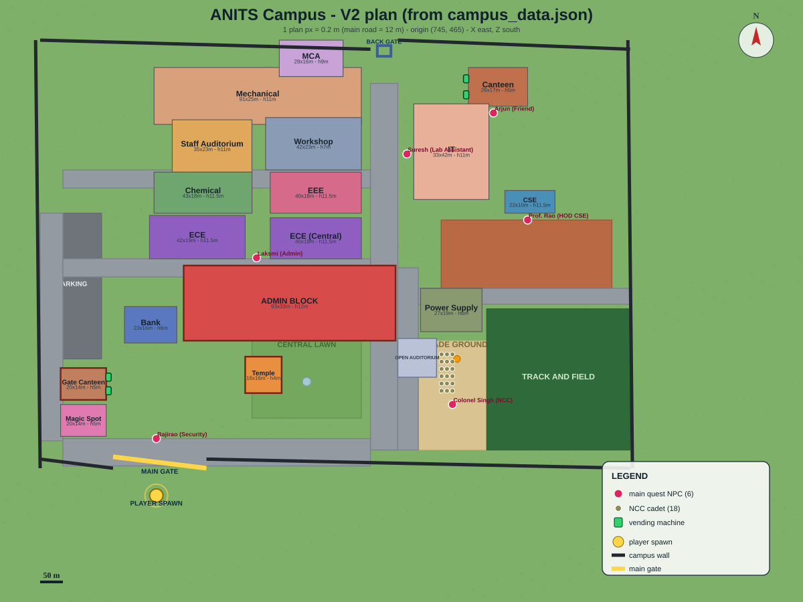

# CAMPUS_MAP.md — the ANITS campus, its coordinates and its navigation



*The SVG above is generated directly from the game's own `BLD`, `ROADS`, `SAND`, `BASK` and
`NCC` tables — it is a plot of the data, not a drawing of the real college. The generator
lives at `%TEMP%\opencode\genmap.mjs` and writes `docs/campus_map.svg` + `docs/_building_table.md`.*

---

## 1. Coordinate systems

The original game stores the campus as a **plan in map pixels** and converts to metres with a
single scale factor:

```js
const S = 0.7;
const wx = p => (p - 215) * S;   // map X -> world X (metres, +X = east)
const wz = p => (p - 250) * S;   // map Y -> world Z (metres, +Z = south)
```

| | Map pixels | World metres |
|---|---|---|
| Origin | (215, 250) | (0, 0) — the centre of campus |
| Campus extent | x 58…368, y 58…432 | x −109.9…107.1, z −134.4…127.4 |
| **World size** | 310 × 374 px | **217.0 m × 261.8 m** |
| North | −Y | −Z |
| Scale | — | 1 map px = 0.7 m |

**Godot helpers (drop-in):**

```gdscript
const MAP_SCALE := 0.7
const MAP_ORIGIN := Vector2(215.0, 250.0)

static func map_to_world(p: Vector2) -> Vector3:
    return Vector3((p.x - MAP_ORIGIN.x) * MAP_SCALE, 0.0, (p.y - MAP_ORIGIN.y) * MAP_SCALE)

static func world_to_map(w: Vector3) -> Vector2:
    return Vector2(w.x / MAP_SCALE + MAP_ORIGIN.x, w.z / MAP_SCALE + MAP_ORIGIN.y)
```

**Keep the map-pixel space as the authoring format.** Every number in the game's data files is
in map pixels; converting them by hand is where porting errors creep in. Store the campus data
as JSON in map pixels and convert at load time.

---

## 2. Perimeter, gates and boundaries

| Element | Map px | World | Description |
|---|---|---|---|
| Perimeter walls | the `WL` list | — | 6 wall segments, 2.4 m high, sandstone `#a59886`, solid colliders |
| West wall | 58,58 → 58,432 | x −109.9, z −134.4…127.4 | full height |
| East wall | 368,58 → 368,432 | x 107.1 | full height |
| North wall (west half) | 58,58 → 234,58 | z −134.4 | the main road cuts through |
| North wall (east half) | 252,58 → 368,58 | z −134.4 | ditto |
| South wall (west of gate) | 58,432 → 100,432 | z 127.4 | |
| South wall (east of gate) | 145,432 → 368,432 | z 127.4 | |
| **Main gate** | x 100–145, z 432 | x −80.5…−49.0 | FBX: two pillars (8.2 m) + two hinged leaves (2.9 m) + centre panel; **locked until Day 1 step 2** |
| **Back Gate** | centre (236, 98), half-width 22 | x −1.4…29.4, z −106.4 | simple gate: two 2.2 × 9 × 2.2 m pillars + a lintel, blue `#3a5f9a`, yellow "Back Gate" label at 12.5 m. The main north–south road passes through it. |

---

## 3. Zones

| Zone | Map px | World X,Z | Contents |
|---|---|---|---|
| `SAND` | 146,357 → 249,427 | −48.3…23.8, 74.9…123.9 | The **Open Auditorium ground**: the sand field with the NCC company, the 18 cadets, Colonel Singh, the flagpole, and the Open Auditorium pavilion itself at map (237,396). |
| `BASK` | 260,251 → 340,314 | 31.5…87.5, 0.7…44.8 | The **basketball court**: a 28 × 15 m painted court centred at world (59.5, 22.75), with a hoop, a ball and 3 benches on the west side. |
| `NCC` | 250,320 → 365,415 | 24.5…105.0, 49.0…115.5 | **Power Supply Room** (the source calls it *"Power Supply Room (was the NCC ground)"*): a substation building at map (306,366), a fenced transformer yard, three internal paths and a dense garden. |
| Parking | 64,163 → 98,290 (world x −108.6…−80.4) | — | 4 stall rows × 41 stalls, 91 cars, planters and an entrance arch. |

---

## 4. Building table (from `docs/_building_table.md`, generated)

| # | Building | Map rect | World centre | Footprint | Height | ~Floors |
|---|---|---|---|---|---|---|
| 1 | Mechanical Block | 101,116,226,156 | −36.0, −79.8 | 87.5 × 28.0 | 10 | ~3 |
| 2 | Stair Auditorium | 115,157,156,196 | −55.6, −51.4 | 28.7 × 27.3 | 11 | ~3 |
| 3 | Workshop | 183,157,222,187 | −8.8, −54.6 | 27.3 × 21.0 | 7 | ~2 |
| 4 | Chemical Block | 109,205,155,239 | −58.1, −19.6 | 32.2 × 23.8 | 11.5 | ~3 |
| 5 | EEE Block | 172,201,232,231 | −9.1, −23.8 | 42.0 × 21.0 | 11.5 | ~3 |
| 6 | CSE Block | 102,246,156,281 | −60.2, 9.4 | 37.8 × 24.5 | 11.5 | ~3 |
| 7 | ECE Block | 170,244,230,279 | −10.5, 8.0 | 42.0 × 24.5 | 11.5 | ~3 |
| 8 | ADMIN BLOCK | 97,291,232,331 | −35.3, 42.7 | 94.5 × 28.0 | 12 | ~3 |
| 9 | IT Block | 260,143,282,237 | 39.2, −42.0 | 15.4 × 65.8 | 11 | ~3 |
| 10 | Civil Block (N) | 276,61,358,117 | 71.4, −112.7 | 57.4 × 39.2 | 14 | ~4 |
| 11 | Civil Block (S) | 288,137,356,224 | 74.9, −48.6 | 47.6 × 60.9 | 14 | ~4 |
| 12 | CSM Block | 286,226,319,246 | 61.2, −9.8 | 23.1 × 14.0 | 7 | ~2 |
| 13 | Canteen | 286,120,314,136 | 59.5, −85.4 | 19.6 × 11.2 | 5 | ~1 |
| 14 | Temple | 102,331,122,349 | −72.1, 63.0 | 14.0 × 12.6 | 4 | ~1 |
| 15 | Magic Spot | 62,349,80,366 | −100.8, 75.3 | 12.6 × 11.9 | 5 | ~1 |
| 16 | Gate Canteen | 62,375,80,395 | −100.8, 94.5 | 12.6 × 14.0 | 5 | ~1 |
| 17 | Bank | 62,400,80,417 | −100.8, 110.9 | 12.6 × 11.9 | 6 | ~2 |

---

## 5. Road network

| # | Map rect | World X | World Z | Width (map px / m) | Connects |
|---|---|---|---|---|---|
| 1 | 64,160,98,345 | −105.7…−81.9 | −63.0…66.5 | 34 / 23.8 | parking strip ↔ west road |
| 2 | 82,345,100,432 | −93.1…−80.5 | 66.5…127.4 | 18 / 12.6 | west road ↔ main gate |
| 3 | 96,332,256,352 | −83.3…28.7 | 57.4…71.4 | 20 / 14.0 | main east–west road (Admin front) |
| 4 | 106,345,139,445 | −76.3…−53.2 | 66.5…136.5 | 33 / 23.1 | gate approach (runs off-campus to the south) |
| 5 | 234,60,252,352 | 13.3…25.9 | −133.0…71.4 | 18 / 12.6 | main north–south road (through the Back Gate) |
| 6 | 100,239,236,246 | −80.5…14.7 | −7.7…−2.8 | 7 / 4.9 | central road between CSE/Chemical and ECE/EEE |
| 7 | 100,281,236,291 | −80.5…14.7 | 21.7…28.7 | 10 / 7.0 | road between the academic blocks and the Admin Block |
| 8 | 157,157,171,285 | −40.6…−30.8 | −65.1…24.5 | 14 / 9.8 | road between the Stair Auditorium and the Workshop |

The main north–south road (5) carries a **median green wall** down its middle; the roads carry
alternating **yellow/white kerb blocks** on both long edges.

---

## 6. Key waypoints (map px → world m)

| Waypoint | Map | World (x, z) | Notes |
|---|---|---|---|
| **Player spawn** | 122,448 | −65.1, 138.6 | outside the main gate, yaw π (facing north into campus) |
| Main gate centre | 122,432 | −64.8, 127.4 | the gate opening spans x 100…145 |
| Day-1 gate objective | 122,396 | −64.8, 102.2 | the "walk through the gate" trigger |
| Day-1 admin objective | 174,337 | −28.7, 60.9 | Laksmi at the Admin hall door |
| CSE / Prof. Rao | 129,287 | −60.2, 25.9 | |
| IT / Suresh | 271,243 | 39.2, −4.9 | |
| Canteen / Arjun | 268,128 | 37.1, −85.4 | |
| Colonel Singh | 214,396 | −0.7, 102.2 | |
| Open Auditorium | 237,396 | 15.4, 102.2 | steps face west |
| Flagpole | 235,377 | 14.0, 88.9 | 14 m pole |
| Bank ATM | ≈ 82, 408.5 | ≈ −92.9, 111.0 | the ATM counter is on the Bank's east wall; the cyan ring stands 1.6 m in front of it |
| Noodle bar | ≈ 82, 357.5 | ≈ −92.9, 75.3 | the counter faces east onto the main road; the cyan ring marks the standing spot |
| Gate canteen machines | 81, 382 / 81, 388 | −93.8, 92.2 / 96.8 | two vending machines on the east wall (`off` ±2.3 from the plot centre) |
| Back canteen machines | 285, 125 / 285, 131 | 49.1, −87.3 / −83.5 | two vending machines on the west wall (`off` ±1.9 from the plot centre) |
| Basketball court centre | 300,282.5 | 59.5, 22.8 | painted 28 × 15 m |
| West wing "Room 204" | 80,175 | −95.5, −52.5 | Day-3 objective |
| West wing "lab" | 80,340 | −95.5, 63.0 | Day-3 wrong door |
| Fest stage | 238,244 | 16.1, −4.2 | Day-9 objective |
| Canteen eating challenge | 268,145 | 37.1, −73.5 | Day-8 objective |

### Walk-time sanity check (straight line, 2.4 m/s walk / 5.6 m/s run)

| From → To | Distance | Walk | Run |
|---|---|---|---|
| Spawn → main gate | 11 m | 5 s | 2 s |
| Gate → Laksmi (Admin) | ~76 m | ~32 s | ~14 s |
| Gate → Prof. Rao (CSE) | ~102 m | ~43 s | ~18 s |
| Prof. Rao → Suresh (IT) | ~104 m | ~44 s | ~19 s |
| Suresh → Arjun (Canteen) | ~81 m | ~34 s | ~14 s |
| Arjun → Colonel (ground) | ~191 m | ~80 s | ~34 s |

> These are the *intended* pacing numbers: a first-day student walks the whole campus in about
> 4 minutes. The Godot port should keep the same distances or the "first day" rhythm changes.

---

## 7. NPC positions on the map

| NPC | Map | World |
|---|---|---|
| Bajirao (Security) | 134,438 | −56.7, 131.6 |
| Laksmi (Admin) | 174,337 | −28.7, 60.9 |
| Prof. Rao | 129,287 | −60.2, 25.9 |
| Suresh | 271,243 | 39.2, −4.9 |
| Arjun (Friend) | 268,128 | 37.1, −85.4 |
| Colonel Singh | 214,396 | −0.7, 102.2 |
| NCC cadets (18) | 208 − r·4.2, 386.25 + k·3.9 | −10.8…−4.9, 95.4…109.0 |
| Route students (9) | see `CHARACTER_AND_NPC_ANALYSIS.md` | — |
| Named walkers (10) | see the same table | — |
| Standing groups (8) | see the same table | — |
| Remy | 118,426 → route | −67.9, 123.2 → … |
| Girl NPCs (9) | `js/girls.js` | — |

---

## 8. Navigation for the port [P]

1. **Static geometry.** The campus is flat except for the Stair Auditorium tiers, the raised
   west footpath (+0.25 m) and the sand kerb. A `NavigationRegion3D` with a baked mesh is
   overkill; a hand-built `NavigationMesh` from the road rects plus the walkable lawns is
   enough. Bake with `NavigationServer3D` at runtime from a set of authored polygons.
2. **The gate is a mission blocker, not a wall.** Use a `StaticBody3D` on each leaf that is
   enabled/disabled by the gate state, so the player can physically pass after Day 1 step 2.
3. **Waypoint graph for the NPCs.** The 9 route students, Remy and the 10 named walkers follow
   fixed loops. A `Path3D` per loop (or a `NavigationAgent3D` on a hand-made path) reproduces
   them exactly.
4. **Mission markers.** The golden beam is a 40 m cylinder + a torus at the objective. In
   Godot: a `MeshInstance3D` with an unshaded, additive material.
5. **Minimap.** The web minimap draws: green base, grey road rects, sand `#dcbc8a`, court
   `#d87b3c`, one coloured rect per building, plus the player arrow. Port it as a
   `SubViewport` + a 170 × 170 `Control` canvas, or bake the static layers into an
   `ImageTexture` once and only redraw the player marker.
6. **Do not use a navmesh for the player.** The original player collides with axis-aligned
   boxes and can step up 1.3 m; a `CharacterBody3D` with `floor_max_angle` and
   `floor_snap_length` reproduces that exactly.

---

## 9. Verification checklist for the port

| Check | Expected |
|---|---|
| Player spawn | world (−65.1, 0, 138.6), yaw 180°, facing the gate |
| Campus bounds | the player cannot leave x −109.9…107.1, z −134.4…127.4 (except along the gate road to the spawn) |
| Gate | closed at the start of Day 1; opens on approach after step 1 completes |
| Building count | 17 + gate + back gate + auditorium + substation + court |
| Walking time spawn → Admin | ≈32 s |
| Day-1 route order | Bajirao → gate → Laksmi → Prof. Rao → Suresh → Arjun → salute → Colonel |
| Distance Admin → CSE | ≈40 m across the central road |

---

## 10. Cross-references

[`BUILDING_INVENTORY.md`](BUILDING_INVENTORY.md) (per-building detail) ·
[`ENVIRONMENT_ASSET_INVENTORY.md`](ENVIRONMENT_ASSET_INVENTORY.md) (roads, planting, props) ·
[`CHARACTER_AND_NPC_ANALYSIS.md`](CHARACTER_AND_NPC_ANALYSIS.md) (who stands where) ·
[`GODOT_ARCHITECTURE.md`](GODOT_ARCHITECTURE.md) (scene layout in Godot) ·
[`GAME_ANALYSIS.md`](GAME_ANALYSIS.md) (mission scripts that use these positions).
