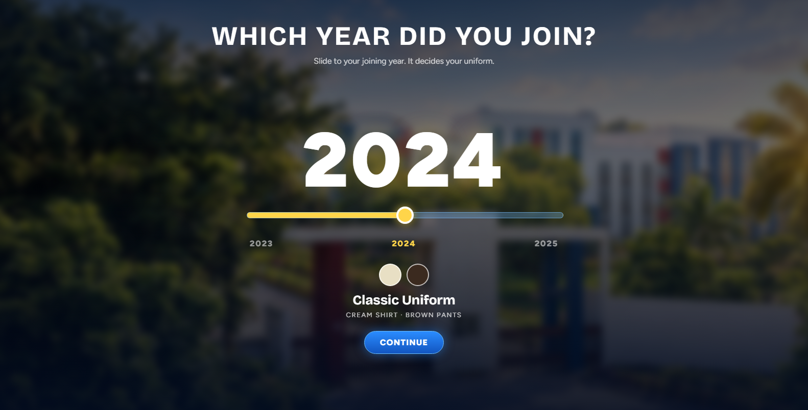
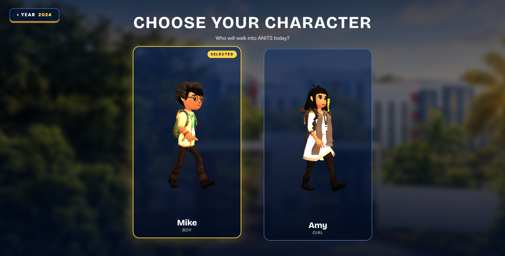

# GAME_ANALYSIS.md — ANITS College Simulation ("ANITS – First Day")

**Purpose:** the behavioural specification of the original web game, written so a Godot 4
rebuild can reproduce it feature-for-feature without re-reading 1.85 MB of minified JavaScript.

**Evidence basis (this document):**

| Source | What it proves |
|---|---|
| `ANITS-WEB GAME/js/game.js` (1.85 MB, 1555 lines) | world, camera, movement, interaction, economy, HUD |
| `ANITS-WEB GAME/js/levels.js` | Day 2–10 mission scripts, quizzes, minigame configs |
| `ANITS-WEB GAME/js/menu.js` | front-end flow, year/character selection, unlocks, loading |
| `ANITS-WEB GAME/js/{core,pause,story,voice,inventory,uniform,touch,save,mini,buddy,chat,callpool,girls,flag}.js` | supporting systems |
| `ANITS-WEB GAME/js/assets.js`, `index.html`, `css/*` | asset manifest, DOM/HUD structure |
| Live runtime (headless Chrome + CDP) | screenshots in `screenshots/`, measured walk speed, runtime counters |
| `https://anits-college.vercel.app/` | identical build (SHA-256 match on `index.html`, `js/game.js`, `js/levels.js`, `assets/models/cadet_boy.glb`) |

**Evidence tags used throughout:**

- **[V] Verified** — read directly from source, or measured at runtime.
- **[O] Observed** — visible in the captured screenshots in `screenshots/`.
- **[U] Unknown** — not determinable from the material available; listed in [`MISSING_INFORMATION.md`](MISSING_INFORMATION.md).
- **[P] Proposed** — a reconstruction decision made by this spec, *not* a fact about the original.

---

## 1. Identity

| Field | Value | Tag |
|---|---|---|
| Document title in `<title>` | `ANITS College Simulation` | [V] `index.html` |
| Game banner | `ANITS` / `COLLEGE SIMULATION` | [V] `menu.js` |
| First-day overlay title | `ANITS - First Day` | [V] `index.html` |
| Publisher credit | `Little Hearts` / `LITTLE HEARTS PRODUCTION` | [V] `menu.js` |
| Developer credit | `AKHILBOSS` | [V] `menu.js` |
| Live URL | `https://anits-college.vercel.app/` | [V] |
| Genre | First-person-adjacent **third-person** campus life-sim / guided tour | [V] camera rig in `game.js` |
| Perspective | Third-person over-the-shoulder, mouse-look, no first-person option | [V] |
| Session structure | Single player, 10 discrete "Days" (levels), each a scripted mission chain | [V] `levels.js` |
| Platforms | Desktop (keyboard+mouse, pointer lock) and mobile/touch (dual-stick + buttons) | [V] `js/touch.js`, `js/mobile.js` |
| Engine (original) | **Three.js r128** (vendored `js/vendor/three.min.js`, 603,445 bytes, `REVISION="128"`), plus `GLTFLoader`, `FBXLoader`, `fflate` | [V] |
| Save system | `localStorage`, one slot per day (`anits-save:v2:<level>`) | [V] `js/save.js` |

> **Naming / trademark note.** "ANITS", the ANITS logo (`assets/img/anits_logo.png`), the
> `Little Hearts` mark and the `AKHILBOSS` credit are the original work's identity and are
> **not** CC0. They are carried over verbatim in this reconstruction because the brief is to
> preserve ANITS identity; they must be used only under the rights holder's authorisation.

---

## 2. Front-end flow (verified end-to-end)

```
[Intro credits] → [Year select] → [Character select] → [Name entry] → [Welcome] →
[Main menu] → [Level select (10 days)] → [Loading screen] → [Gameplay]
                    ↑                                                        │
                    └──────────────── Level complete overlay ──────────────┘
```

| # | Screen | Content | Advance trigger |
|---|---|---|---|
| 0 | Cinematic studio intro (`js/cinematic.js`) | A self-contained DOM/CSS intro with synthesised audio: bars → ANITS logo (with a shine) → Little Hearts mark → *"A Little Heart Production"* → *"Developed by akhilboss"* → *"Tap to begin"*. It has **three timelines** — `full` (≈11 s), `short` (≈4.1 s) and `reduced` (≈5.8 s) — and remembers itself in `localStorage['lhp-cinematic-seen']`. | the `Skip` button (after 1 s) or a tap |
| 1 | Intro | `LITTLE HEARTS PRODUCTION`, typing `Developed By Boss` at t+3.3 s | click to skip, or auto at t+7.6 s |
| 2 | Year select | slider 2023–2025; shows uniform name, shirt/pants swatches and a description | `CONTINUE` (`ys-go`) |
| 3 | Character select | two cards, **Mike** (boy) and **Amy** (girl), each rendering the *real* 3D model live in a canvas (walk clip + year uniform recolour) | click a card (450 ms fade → next screen) |
| 4 | Name entry | text input, max 14 characters, `CONTINUE` disabled until non-empty | typing + `CONTINUE`/Enter |
| 5 | Welcome | types `WELCOME` → *player name* → `TO ANITS COLLEGE` | auto after ≈3.4 s |
| 6 | Main menu | `START GAME`, `SETTINGS` (volume, change player, reset progress), `PLAYING AS <name> · MIKE/AMY · YEAR <y>` | click |
| 7 | Level select | 10 cards (`DAY n` + name), locked cards show a padlock and shake + toast when clicked | click an unlocked day |
| 8 | Loading | ANITS logo with a sweeping shine, random campus quote rotating every 3.6 s, progress bar | `CLICK ANYWHERE TO START` (enabled after assets load) |
| 9 | Gameplay | 3D world + HUD | — |

**Uniforms by joining year** [V] (`menu.js` `YINFO`, `js/uniform.js`):

| Year | Name | Description | Shirt | Pants |
|---|---|---|---|---|
| 2023 | Rose Uniform | `LIGHT PINK SHIRT · BLACK PANTS` | `#f0a6c4` | `#16161b` |
| 2024 | Classic Uniform | `CREAM SHIRT · BROWN PANTS` | `#e8dfc4` | `#3b2a1f` |
| 2025 | New Uniform | `SKY BLUE SHIRT · NAVY PANTS` | `#87ceeb` | `#101a4a` |

Year 2024 is the default and the "original" look. 2023/2025 swap the body texture
(`assets/models/uni2023_*`, `uni2025_*`) and recolour three vertex-colour bands; the girl
character additionally gets a generated **chunni** mesh (navy for 2025, black for 2023)
built procedurally from shoulder/hip bones. [V]




**Level names** [V] (`levels.js` `window.__LVINFO`):

| Day | Name | Completion line |
|---|---|---|
| 1 | Explore the College | "You toured every corner of ANITS, met the staff, found a friend and saluted the NCC company. Jai Hind!" |
| 2 | Pay the Fees | "Fees paid, receipt stamped. You are officially an ANITS student!" |
| 3 | Find Your Classroom | "After a wrong lab and a lost corridor, you found your classroom!" |
| 4 | Library Card | "Quiz passed. Your library card is in your pocket!" |
| 5 | Basketball Event | "Nothing but net! The court has a new star." |
| 6 | NCC Parade | "You marched with the NCC company. Colonel Singh is proud!" |
| 7 | Lab Manual Run | "All signatures collected. The lab is open for you!" |
| 8 | Canteen Challenge | "Chai, samosa and a win. What a canteen day!" |
| 9 | Fest Stage | "The crowd is still cheering your name!" |
| 10 | First Classroom | "Your first class at ANITS is done. The story has just begun!" |

---

## 3. Day 1 — the main-gate tutorial

Mission steps are an array of step objects; the HUD shows `DAY n · MISSION i / N` plus the
step text, and a golden beam marker (`CylinderGeometry` r=0.9, h=40 + torus ring) is placed at
the current objective. [V]

| # | Objective | Trigger |
|---|---|---|
| 1 | *Talk to Security Guard Bajirao beside the main gate (press E near him).* | Talk to `guard` |
| 2 | *Walk through the ANITS main gate. (Hold Shift to run)* | Reach map `(122,396)`; **the gate unlocks at this step** (`gateLocked=false` once `si>=1`) |
| 3 | *Go to the Admin Block and talk to Laksmi (Admin).* | Talk to `clerk` |
| 4 | *Meet Prof. Rao at the CSE Block.* | Talk to `prof` |
| 5 | *Collect your lab manual from Suresh at the IT Block.* | Talk to `suresh` |
| 6 | *Meet your friend <Arjun> at the Canteen.* | Talk to `arjun` |
| 7 | *Go to the Open Auditorium grounds and salute the NCC cadets (press G near Colonel Singh).* | `G` within 16 m of ≥1 cadet |
| 8 | *Talk to Colonel Singh.* | Talk to `colonel` |

Notes [V]:
- Steps 1–8 have fixed dialogue in `NPC[id].L[<stepIndex>]`; step 0 of every NPC is also its
  idle line.
- `next()` increments the step index; the mission HUD title is written at that moment.
- Completing a step that carries `done()` fires the side effect (e.g. Day 2 fee payment).
- Day 1 ending shows the "Day 1 Complete!" overlay with `Keep exploring ANITS` — the world
  stays open and free-roam is allowed after the story ends.
- **Every day ≥ 2 is prefixed with two gate steps** [V] `levels.js`:
  1. *Show your ID card to Security Guard Bajirao at the main gate (press E near him, then press SHOW in your bag).* — opens the inventory in "ask" mode; the ID card is auto-issued if missing.
  2. *Walk through the main gate and into the college.* at map `(122,418)` r=5.

---

## 4. Days 2–10 — mission chains

`levels.js` defines steps with fields `t` (text), `at` (map position + radius), `npc`,
`salute`, `lines` (per-NPC dialogue), `ok()` (gate condition), `done()` (side effect),
`chk()` (counter condition), `mini` (minigame config) and `say` (subtitle). [V]

### Day 2 — Pay the Fees
1. Ask Laksmi for the fee slip → *"Fees? Yes, here is your fee slip. The total is Rs. 250."*
2. **Withdraw at least ₹250** from the bank ATM (press `E` near the bank) — condition `wallet() >= 250`.
3. Pay ₹250 to Laksmi — `ok: wallet()>=250`, `done: pay(250)` → *"Thank you! Rs. 250 received. Here is your receipt."*
4. Show the receipt to Prof. Rao → *"Ah, the fee receipt. Very good, you are officially a student!"*

### Day 3 — Find Your Classroom
1. Prof. Rao → *"Your classroom? Check the west wing, Room 204."*
2. Search the **south corridor of the west wing** — map `(80,340)` r=6 → *"You: Hmm, this looks like a lab, not a classroom..."*
3. Search the **north end of the west wing, Room 204** — map `(80,175)` r=6 → *"You: Room 204! Finally... but who is waving at me?"*
4. Meet Arjun at the Canteen → *"Hey! Over here! I saved you a seat in the right room!"*

### Day 4 — Library Card
1. Collect the library card form from Laksmi.
2. Walk to the library in the west wing — map `(80,175)` r=6.
3. **Library quiz** — answer 2 of 3 correctly:
   - *What does CSE stand for?* → Computer Science & Engineering
   - *What should you keep inside a library?* → Silence
   - *Which college is this game about?* → ANITS
4. Collect the library card from Suresh at the IT Block → *"Your library card is ready! Please keep silence inside."*

### Day 5 — Basketball Event
1. Go to the Basketball Court — map `(290,275)` r=6 → *"Basketball players: Shoot your shots, fresher!"*
2. **Basketball shootout** — 5 shots, need 3. Press `SPACE` while the bar is in the green zone.
3. Celebrate with Arjun at the Canteen.

### Day 6 — NCC Parade
1. Report to Colonel Singh at the Open Auditorium grounds.
2. **Parade drill** — 8 commands, need 6 correct, 1.7 s per prompt; keys ↑ / ← / →, commands *ATTENTION! / LEFT TURN! / RIGHT TURN!*
3. **Salute the NCC company** (`G` near the cadets).
4. Report back to Colonel Singh → *"Excellent parade! You marched like a true cadet. Jai Hind!"*

### Day 7 — Lab Manual Run
1. Get the lab manual form from Suresh (IT Block).
2. Get Prof. Rao's signature (CSE Block).
3. Get the stamp from Laksmi (Admin Block).
4. Return the stamped form to Suresh → *"Perfect! All signatures are complete. Lab entry unlocked!"*

### Day 8 — Canteen Challenge
1. Head to the Canteen — map `(268,145)` r=7.
2. **Buy and drink 2 different cold drinks** at a vending machine — condition `tried() >= 2`.
3. **Samosa speed-eating** — tap `SPACE` 25 times in 8 seconds.
4. Collect your prize from Arjun → *"You won! Chai and samosa are on me!"*

### Day 9 — Fest Stage
1. Go to the fest stage near the IT Block road — map `(238,244)` r=7 → *"Lights, camera, fest!"*
2. **Dance battle** — 10 arrow-key prompts, need 7, 1.4 s per prompt; ↑ JUMP! / ↓ DROP! / ← SPIN LEFT! / → SPIN RIGHT!
3. Meet Arjun backstage at the Canteen.

### Day 10 — First Classroom
1. Go to Prof. Rao at the CSE Block.
2. **First class quiz** — 3 of 4 correct:
   - *Which language is `print("hi")` written in?* → Python
   - *2 + 2 * 3 = ?* → 8
   - *What does a loop do?* → Repeats instructions
   - *Where do freshers meet after class?* → Canteen
3. Talk to Prof. Rao to finish → *"Excellent! Class dismissed. Welcome to ANITS, your best four years begin now!"*

**Level completion rewards** [V] `menu.js` `__levelDone`: Day 1 → **Student ID Card**, Day 2 →
**Fee Receipt**, Day 4 → **Library Card**. The overlay renders the card and offers
`Next Level (Day n)` / `Level Select` via `sessionStorage['anits-go']` + page reload.

---

## 5. Controls

### Desktop (verified in `index.html` overlay + `game.js` key handling)

| Input | Action | Source |
|---|---|---|
| `W` `A` `S` `D` / arrows | Move (camera-relative) | [V] |
| `Shift` (either) | Run (5.6 m/s) | [V] |
| `E` | Talk / Use / Interact | [V] |
| `G` | Salute (NCC) | [V] |
| `B` | Open inventory (bag) | [V] `inventory.js` |
| `Esc` / `P` | Pause menu | [V] `pause.js` |
| Mouse drag / pointer-lock | Look (yaw 0.006, pitch 0.004 per pixel) | [V] |
| `Q` / `Z` | Rotate camera ±1.8 rad/s | [V] |
| `I` | Invert Y axis | [V] |
| `Space` | Minigame input (shoot / mash) and arrow keys during drills | [V] |
| `1`–`5` | Quick-buy in shop / bank / noodle menus | [V] |
| `Esc` | Close shop, inventory, minigame | [V] |

### Mobile / touch [V] `js/touch.js`

| Control | Detail |
|---|---|
| Left thumb | Floating **MOVE** joystick; push past 0.93 to run, or tap **RUN** to lock running |
| Right thumb | **LOOK** joystick (yaw 430 px/s, pitch 320 px/s at full push); dragging the 3D view also looks (sensitivity 1.25) |
| Buttons | `E TALK/USE`, `G SALUTE`, `SIT BENCH` (contextual), `RUN`, `BAG`, full-screen toggle |

### Gamepad [U]
No gamepad input was found in the source. **Do not implement** unless requested.

---

## 6. Movement and camera

### Character controller [V]

| Parameter | Value |
|---|---|
| Walk speed | 2.4 m/s (measured on the live build: ≈2.3 m/s including accel ramp) |
| Run speed | 5.6 m/s (measured ≈5.6 m/s) |
| Energy-drink boost | ×1.3 for 30 s (`boost = 30`, countdown shown in the wallet HUD) |
| Jump | **None** |
| Step-up limit | 1.3 m (`max(groundH(a), groundH(b)) - pl.y <= 1.3`) |
| Speed smoothing | `pl.sp += (target - pl.sp) * min(1, dt*9)` |
| Collision | Axis-aligned box list (`colliders`), swept by sampling the target XZ against each box |
| Ground height | `groundHeightAt(x,z)` — terrain height field from the stair-auditorium heightmap + flat zones |

### Camera rig [V]

| Parameter | Value |
|---|---|
| Type | Third-person orbit-follow, no collision "spring arm" |
| Default distance | 5.4 m behind the player |
| Dialogue / drinking / phone | 3.2 m |
| Inside the Admin Office | 3.4 m |
| Eye height | player `y + 1.5 m` |
| Look target | player `y + 1.35 m` |
| Building avoidance | Distance is reduced in 0.4 m steps down to **1.2 m** while the sample point is inside a collider |
| Position smoothing | `cam.position.lerp(V, min(1, dt*10))`; never below `ground + 0.4 m` |
| Pitch | clamped 0.05 – 1.1 rad (≈3° – 63° down) |
| Yaw | mouse 0.006 rad/px, `Q`/`Z` 1.8 rad/s, damped by `LOOK` sensitivity slider |
| FOV | 60° vertical; far plane 800 (desktop) / 560 (mobile) |
| Admin-hall clamp | Inside the Admin Block the camera X is clamped to the hall width and Y to 2.6 m; outside, Z is snapped to the hall face |
| Office clamp | Inside the office the camera is clamped to the room box and Y to 0.5–3.05 m |

---

## 7. Interaction model

`interact()` (key `E`) resolves a strict priority chain [V]:

1. If a shop is open → close it.
2. If drinking → ignore.
3. If seated → stand up.
4. **Admin Office door** (`officeDoor()`, within 2.8 m of the hall door and on the same floor) → enter/exit.
5. **Service counters** (bank ATM, noodle bar) — only if closer than the nearest vending machine *and* the nearest NPC.
6. **Vending machine** (`nearVM()`, 3.4 m) — only if closer than the nearest NPC.
7. **Bench** (`benchNear()`) → sit (only if closer than the nearest NPC).
8. **NPC** (`near()`, 3.8 m) → start dialogue.

Dialogue: one line at a time, auto-advancing; `E`/click skips to the next line; after the last
line the NPC may hand over to the chat system, otherwise the mission step advances.
`near()` skips NPCs flagged `off` (hidden) or `nt` (non-talkable).

**Salute (`G`)** [V]: every NCC cadet within **16 m** switches to the salute animation, turns to
face the player and shouts "Jai Hind!" in a staggered chorus with per-cadet pitch/rate and
distance-based volume; the group answers after 1.7 s and the mission advances.

**Sitting** [V]: `E` near a bench starts a sit-down clip, slides the player onto the seat and
aligns yaw; `E` again stands up. 11 sittable seats exist (7 park benches + 4 office-sofa
places).

---

## 8. HUD and UI

| Element | Id | Content | Notes |
|---|---|---|---|
| Mission panel | `#mis` | `DAY n · MISSION i/N` + objective text + key hints | top-left |
| Subtitle strip | `#sub` | one line at a time, chunked so it fits one line; auto-hides | Telugu variant selectable |
| Dialogue box | `#dlg` | `<b>Name:</b><span>line</span>` | click to advance |
| Wallet strip | `#wal` | `₹<wallet> | 🍤 n/10 drinks tried | ⚡ boost Ns` | updates on any purchase/drink |
| Energy bar | `#en` | `ENERGY` + bar + numeric + `+N Energy` popup | 0–100 |
| Shop panel | `#shop` | title, wallet, item rows, hotkeys | used by vending machines, bank and noodle bar |
| Minimap | `#mm` | 170×170 canvas: green base, grey roads, sand field, orange court, building rects, player arrow | redrawn every frame |
| Pause menu | injected by `pause.js` | Resume / Restart Level / Level Select / Settings (voice, effects, look sliders) + subtitle language | `Esc` / `P` |
| Inventory | `#inv` | 3 slots: Student ID Card, Fee Receipt, Library Card | `B`, plus the `SHOW` prompt at the gate |
| Call overlay | `#call` | incoming-call ring, name, Decline/Accept, then a captions panel and End call | phone prop in the player's hand |
| Spicy overlay | `#spicy` | red vignette + "SPICY!!" pulse for 3.6 s | Buldak noodles |
| Credits | `#cred` | *"Temple model · "Indian Temple" by pranavaryakirtik · CC-BY-4.0"* | permanent, bottom-left |

---

## 9. Economy, energy and shops

### Money [V]

| Item | Value |
|---|---|
| Starting wallet | ₹200 |
| Starting bank balance | ₹2000 |
| Tuition fee (Day 2) | ₹250 |
| ATM quick amounts | ₹100 / ₹200 / ₹500 / ₹1000 + custom (any integer ≤ balance) |

### Cold drinks (10 SKUs, `DR` table) [V]

| Id | Name | Price | Type | Energy |
|---|---|---|---|---|
| `happy` | Happy Faces Soda | ₹20 | soda | +20 |
| `tvgirl` | TV Girl Soda | ₹25 | soda | +20 |
| `bsoda` | BSODA | ₹20 | soda | +20 |
| `noob` | Noob Soda | ₹20 | soda | +20 |
| `sky` | Sky Cola | ₹25 | soda | +20 |
| `bloxy` | Bloxy Cola | ₹30 | soda | +20 |
| `nyan` | Nyan Cat Soda | ₹30 | soda | +20 |
| `night` | Night Blizzard | ₹45 | **energy** | +35 **and 30 s speed boost** |
| `monster` | Monster Energy | ₹60 | **energy** | +35 **and 30 s speed boost** |
| `redbull` | Red Bull | ₹60 | **energy** | +35 **and 30 s speed boost** |

Drinking is a staged animation: the can drops into the tray (0.35 s), the player picks it up,
the character plays the *Drinking* clip, and the energy bar pops. Trying all ten drinks triggers
*"You have tried every drink at ANITS! Legend!"* [V].

### Noodles (Magic Spot Noodle Bar) [V]

| Dish | Price | Energy | Note |
|---|---|---|---|
| Indian Masala Noodles | ₹60 | +20 | |
| Chinese Chow Mein | ₹80 | +25 | |
| Japanese Ramen | ₹120 | +30 | |
| Korean Buldak Fire Noodles | ₹150 | +50 | *spicy* screen effect + speed boost |

### Energy rules [V]

- Starts at **40 / 100**; capped at 100.
- **Nothing drains energy** — there is no hunger/stamina decay in the original.
- Only drinks (+20 / +35) and noodles (+20…+50) raise it.
- `[P]` For a faithful port, keep this: energy is a collectible, not a survival meter.

---

## 10. Minigames [V] `js/mini.js`

| Kind | Config in `levels.js` | Interaction |
|---|---|---|
| `shoot` | 5 shots, need 3, green bar | `SPACE` to release the shot; ball is a real projectile with rim/backboard outcomes; camera walks the player to the free-throw line facing the nearest hoop |
| `cmd` | 8 commands, need 6, 1.7 s each (parade); 10 commands, need 7, 1.4 s each (dance) | press the called arrow key within the time limit |
| `mash` | 25 taps in 8 s | `SPACE` mashing |
| `quiz` | 2 of 3 (library), 3 of 4 (first class) | 4-option multiple choice |

---

## 11. Phone calls, friend and chat

**Phone calls** [V] `js/story.js`:
- The best friend calls automatically **18–38 s** after the overlay closes (`schedule(18 + random*20)`), retrying every 2 s until the call can start.
- Calls only happen while `si` (mission step) is in range: `si < 5` on Day 1, `2 ≤ si < 5` on later days.
- The overlay shows an incoming-call ring with Decline/Accept; accepting starts a caption-driven conversation with the `callpool.js` dialogue bank; `End call` closes it.
- A call blocks movement, interaction and mini-games (`canCall()`).
- The phone prop (`b_phone.bin`) is attached to the player's hand during the call.
- **Debug hook:** `window.__callTest = {open, accept, decline, end}` and `window.__nextCall(fn)`; `?callin=<seconds>` overrides the first-call delay (used by the screenshot rig with `?callin=999999`).

**Buddy** [V] `js/buddy.js`: from Day 2 there is a **60 % chance** a friend joins the player and
walks alongside; `window.__buddyDay` disables it (used for clean screenshots).

**Chat** [V] `js/chat.js`: after a dialogue line ends, the player can keep chatting with the
same NPC; the chat panel is suppressed while the mission overlay is open.

---

## 12. Save, progression and persistence [V]

| Key | Store | Contents |
|---|---|---|
| `anits-profile` | localStorage | `{name, char, year}` |
| `anits-unlocked` | localStorage | highest unlocked day (1–10) |
| `anits-items` | localStorage | `{id, fee, lib}` flags |
| `anits-vol` | localStorage | voice volume 0–1 |
| `anits-sfx` | localStorage | effects volume |
| `anits-look` | localStorage | look sensitivity |
| `anits-sublang` | localStorage | `en` / `te` subtitle language |
| `anits-save:v2:<lvl>` | localStorage | `{v:1, wallet, bankBal, energy, si, x, z, yaw, t}` |
| `anits-intro`, `anits-go` | sessionStorage | intro-seen flag, next-level hand-off |

Autosave runs every **4 s** plus on `beforeunload`, `pagehide` and `visibilitychange`.
Restore re-enters the mission step index and the player position; a corrupt/invalid payload is
deleted and ignored (`valid()` bounds-checks every field). `?reset=1` clears the save.

---

## 13. Rendering, lighting and audio

### Renderer [V]

| Setting | Desktop | Mobile (`MOB` = coarse pointer / mobile UA) |
|---|---|---|
| Antialias | on | **off** |
| Pixel ratio | `min(devicePixelRatio, 2)` | `min(devicePixelRatio, 1.25)` |
| Shadow type | `PCFSoftShadowMap` | `PCFShadowMap` |
| Shadow map | 2048² | 1024² |
| Shadow camera | ±60 m, far 300 | ±44 m, far 300 |
| Shadow auto-update | on | **off** (static shadows) |
| Adaptive pixel ratio | yes — frame-time based, drops to ≤1.25 when slow | same |

### Lighting and sky [V]

- Hemisphere light `0xdcefff` / `0x6d8a5a`, intensity 0.66.
- Directional sun `0xffeccb`, intensity 0.78, `bias -0.0006`, `normalBias 0.05`.
- Scene background + fog `0xd8edf8`, linear fog **170 → 540 m**.
- Custom sky-dome shader (top `0x2f86de` → mid `0x8fcaf4` → horizon `0xd8edf8`) with a sun glow
  and hash-based stars; a cloud group drifts at 0.004 rad/s and follows the camera.
- **Fixed daytime** — the day/night cycle code was removed ("day/night cycle removed"); a
  dormant `DN` state object remains. [V]

### Audio [V]

- **632 MP3 voice clips** in `assets/audio/`, mapped by two JSON banks:
  `clips.json` (340 entries) and `clips_girl.json` (310 entries). Each entry is
  `[teluguText|null, mp3Path]`.
- `js/voice.js` plays the MP3 when present; otherwise it falls back to the **browser speech
  synthesis** with a per-character pitch/rate profile
  (`you`, `youF`, `sushma`, `arjun`, `guard`, `clerk`, `prof`, `suresh`, `colonel`), preferring
  `en-IN` voices.
- Girl characters use the female clip bank; the female cadet line *"Jai Hind! Sir is watching,
  I cannot talk now!"* has a Telugu translation used with a `te-IN` voice when present.
- The NCC "Jai Hind!" chorus plays one MP3 per cadet with per-cadet playback rate and
  distance-attenuated volume (0.25 – 1.0, ×0.6).
- Sound effects are **synthesised with WebAudio** (no files): UI blips, can drop, purchase,
  error buzz, spicy noise burst.
- Subtitles can be switched to Telugu (`anits-sublang`).
- **No continuous background music track was found in the build.** [V] — confirm before
  shipping a silent campus (see `MISSING_INFORMATION.md`).

---

## 14. Runtime census (measured on the live build) [V]

| Metric | Value |
|---|---|
| Buildings (`BLD`) | 17 |
| Road rectangles | 8 |
| Named zones | `SAND` (Open Auditorium ground), `BASK` (basketball court), `NCC` rect (now the **Power Supply Room**) |
| NPCs | 64 |
| Vending machines | 4 |
| Parked cars | 91 |
| Trees | 150 |
| Bushes | 130 |
| Lamp posts | 14 |
| Sittable seats | 11 |
| Grass tuft instances | 6,923 in 46 chunks (distance-culled to a 130 m radius) |
| Voice clips | 632 MP3 |
| Campus world extent | ≈ **217 m × 262 m** |

---

## 15. Port risk register (what a Godot rebuild must get right)

| # | Risk | Mitigation |
|---|---|---|
| 1 | The whole campus is one 217×262 m scene with thousands of objects | Use Godot `MultiMesh` for grass/trees/kerbs; keep one `Node3D` root per zone; cull by `VisibleOnScreenNotifier3D` / distance |
| 2 | Third-person camera must not clip into the Admin Block and must duck under overhangs | Implement the same "step the distance down to 1.2 m" algorithm and the Admin-hall clamp |
| 3 | Mission logic is data-driven (`STORY` array of step objects) | Port the step schema 1:1 to a `MissionStep` resource + a `MissionRunner` (see `GODOT_ARCHITECTURE.md`) |
| 4 | Voice lines are data (`clips.json`) | Keep a `LineId → {telugu, mp3, tts_fallback}` resource; `LabeledAudioStream` in Godot |
| 5 | Day/night was removed; do not "improve" it back in | Fixed sun + sky shader equivalent (`ProceduralSkyMaterial`) |
| 6 | Energy never drains | Keep it as a collectible counter |
| 7 | 632 MP3s at ~24 kB each = ~15 MB | Convert to OGG Vorbis, load lazily per bank, stream long lines |
| 8 | Touch UI must coexist with the HUD on small screens | Anchor the two joysticks to screen corners; keep the mission panel above the safe area |

---

## 16. Cross-references

| Document | Contents |
|---|---|
| [`BUILDING_INVENTORY.md`](BUILDING_INVENTORY.md) | the 17 buildings, the gate, the auditorium, the substation, the canteens |
| [`ENVIRONMENT_ASSET_INVENTORY.md`](ENVIRONMENT_ASSET_INVENTORY.md) | roads, vegetation, props, models, textures, audio assets |
| [`CHARACTER_AND_NPC_ANALYSIS.md`](CHARACTER_AND_NPC_ANALYSIS.md) | player, 64 NPCs, dialogue, animations, voices |
| [`CAMPUS_MAP.md`](CAMPUS_MAP.md) | coordinate system, map drawing, zones, navigation |
| [`GODOT_ARCHITECTURE.md`](GODOT_ARCHITECTURE.md) | Godot project structure, scenes, systems |
| [`ASSET_MAPPING.md`](ASSET_MAPPING.md) | original asset → Godot replacement mapping |
| [`FREE_GODOT_ASSETS.md`](FREE_GODOT_ASSETS.md) / [`EXTERNAL_ASSET_LIBRARY.md`](EXTERNAL_ASSET_LIBRARY.md) | CC0 replacements with verified licences |
| [`RECONSTRUCTION_ROADMAP.md`](RECONSTRUCTION_ROADMAP.md) | build order and acceptance criteria |
| [`MISSING_INFORMATION.md`](MISSING_INFORMATION.md) | everything still unknown |
